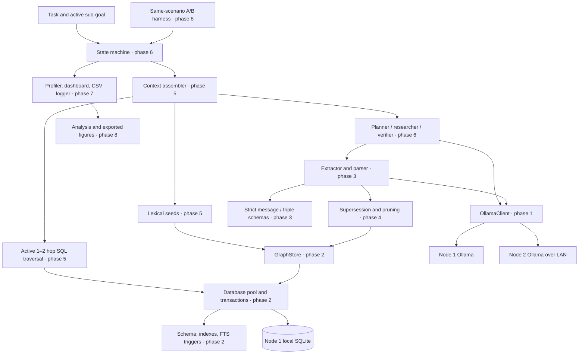

# DynaGraph: the complete architecture

DynaGraph is designed to give collaborating local agents a durable, selective
memory. Instead of repeatedly passing every previous message, the finished system
stores facts in a graph, retrieves a small relevant neighborhood for the next
sub-goal, updates facts when the world changes, and measures the result against a
linear-history baseline.

Open the [interactive architecture atlas](architecture.html) for the component
map. It is a self-contained HTML file with no CDN, remote font, JavaScript library,
or API dependency. Open it directly in a browser, or serve the repository locally:

```bash
python3 -m http.server 8765 --bind 127.0.0.1
```

Visit **http://127.0.0.1:8765/docs/architecture.html**. Stop the server with Ctrl+C.

Use the Dark mode / Light mode toggle to change the entire atlas, including the
canvas, cards, inspector, and SVG exports. The first visit follows the browser
preference; an explicit choice is saved locally when browser storage is available.

Use the mouse wheel or +/− buttons to zoom and drag to pan. Click a component for
its purpose, inputs, outputs, interfaces, constraints, and incoming/outgoing
connections. Search includes hidden supporting files; selecting a result reveals
it. Phase buttons focus a subsystem. Workflow views trace a turn, persistence,
retrieval, or the experiment. **Supporting files** adds package initializers,
tests, configuration, and documentation. **Export SVG** saves a standalone vector
diagram of the current visible component set. Reset first for an unhighlighted
whole-system export; enable Supporting files for the complete inventory.

The map describes the **finished target design**, while its status labels reflect
the current checkout: all **eight phases exist**; an initial **80-turn measured experiment is complete**.
See the [case study and evidence](results/study-20261111-002/README.md) for the two paired
repetitions, costs, accuracy, limitations, and disclosed unsuccessful first attempt.
Components have wider gutters and connectors use distinct perimeter ports. An
orthogonal router reserves separate tracks and keeps lines out of every card.
Parallel line sections cannot overlap; perpendicular crossings use a background
halo to distinguish one passing over another. Normal and highlighted lines are
50% thicker than in the original atlas.

Connections touching planned modules describe intended integration; they are not
claims that those calls already execute. Packaging and documentation connections
indicate organization or use, rather than an execution sequence. Paths/interfaces
for future modules are design responsibilities, not implemented method contracts.

## Where the system runs

| Location | Finished responsibilities |
| --- | --- |
| Node 1 | All Python modules, agent coordination, local Ollama, extraction client, SQLite, retrieval, governance, telemetry, and experiments. |
| Node 2 | A secondary Ollama service with a locally installed quantized model, reached over private LAN HTTP. |
| Node 1 local disk | SQLite graph/WAL state, local metric CSV files, and exported experiment figures. |

The baseline is two Intel N100-or-better computers with 8–16 GB RAM each.
Models and CPU budgets are configurable for available hardware. Logical agents
are roles, not separate machines: a research role can execute Python on Node 1
while requesting generation from Node 2. No shared network database, hosted graph
service, cloud LLM API, API key, or paid service is required. Initial software and
model downloads are separate from offline/LAN operation.

## One turn in the finished workflow

1. **Choose work.** The state machine selects an active agent and sub-goal.
2. **Recall relevant state.** The context assembler asks the seed matcher for
   active entities, expands their neighborhood through SQL traversal, and emits
   at most 1,000 graph-context tokens.
3. **Run the role.** A planner or verifier normally uses Node 1 inference; a
   research role normally uses Node 2. The shared agent contract combines role
   instructions, task, and retrieved context before calling the HTTP client.
4. **Extract new facts.** The response becomes an `AgentMessage`. The extractor
   requests JSON, the parser repairs only supported syntax defects, and Pydantic
   validates semantic triples. Endpoint wording must occur in the source.
5. **Accept and persist updates.** The controller submits accepted facts
   through supersession policy to transactional graph storage. Single-valued
   stale facts become `SUPERSEDED`, with traceable provenance.
6. **Maintain memory.** Each committed turn can include one bounded pruning
   batch using recency, frequency, centrality, and turn decay. Pinned facts are
   protected; an externally owned daemon remains optional.
7. **Observe and repeat.** The profiler records the turn, the dashboard displays
   its state, the logger writes metrics, and the controller advances until the
   task or turn budget is complete.

The controller now executes steps 1–7 and saves durable checkpoints and telemetry. Each turn's
usage, governed graph updates, optional pruning, and checkpoint commit together.
A restart resumes the next uncommitted role without replaying committed facts.
The standalone extractor still returns data without persisting it; the controller
owns that integration. The Rich CLI polls workflow state and exports committed
metrics to CSV. Display/export errors cannot undo an accepted checkpoint.



This Mermaid view summarizes the target **data flow**. The interactive map shows
individual files and call/use relationships, so its arrows are not necessarily
in the same direction as a returned value. For example, an assembler calls
traversal, while retrieved facts return to the assembler.

## What graph memory contains

An **entity** has a display name, canonical name, type, description, JSON
properties, pin flag, status, and timestamps. A **triple** connects subject and
object entity IDs with a predicate, JSON properties, confidence, status, and
timestamps. FTS5 indexes entity names and descriptions for lexical prefix lookup.
Foreign keys preserve relationship integrity, and triggers update FTS in the
same transaction as entity changes.

For a predicate explicitly configured as single-valued, an update such as
`Project Cedar → primary_database → PostgreSQL` can supersede an earlier
`Project Cedar → primary_database → SQLite`. Retrieval should use the active
value while preserving the old fact's provenance. This policy must not treat
every multi-object relationship as a contradiction.

Current identity handling normalizes whitespace and case; it does not infer
arbitrary aliases or entity equivalence. Likewise, current `GraphStore.delete_*`
methods physically delete data; `Pruner` instead marks eligible entities and their
active facts `PRUNED`. Pinned entities and the endpoints of their active facts are
protected. Raw CRUD bypasses governance; use `GovernedWriter` for accepted facts.

Schema version 2 introduced `entity_memory` for access counts/time/turns and
`supersession_edges` for explicit fact-to-fact `SUPERSEDES` events. Reasserting
an older SPO reuses its triple row, while ordered event IDs retain replacement
history. These provenance edges are separate from semantic entity edges.
Version 3 adds `workflow_runs` and `workflow_turns` for durable progress, actual
node/role results, global governance turns, and guarded ownership recovery.

Retention uses weighted recency, time-faded frequency, active incident-edge
centrality, and elapsed-turn decay. The pruner scans bounded pages and only
considers nodes with at most one active incident fact in that pass. The daemon
must be started explicitly and receives turns from its caller. See the
[Phase 4 protocol](testing/phase4.md) for formulas, default parameters, pin
semantics, access recording, and backup/upgrade instructions. Retrieval now selects bounded active neighborhoods in SQL and emits budgeted
Markdown/JSON. The default count is a conservative byte-level BPE bound; a
correct local model-specific counter can be injected. Usage recording is
explicit after context is supplied by standalone callers. The Phase 6 controller
records usage and facts at successful turn checkpoints.

## How the experiment evaluates the system

The benchmark harness runs a shared 15–20 turn scenario with injected state
changes under two conditions:

| Condition | Context strategy | What is held comparable |
| --- | --- | --- |
| A: linear | Pass prior task/answer turns in a bounded oldest-first window. | Scenario, node/model choices, hardware, generation settings, and task truth checks. |
| B: graph | Extract/persist facts and retrieve bounded current graph context. | The same controls, with graph memory as the experimental difference. |

Telemetry feeds local CSV records. Analysis compares prompt-token consumption,
latency by turn, and factual consistency after state changes; plotting exports
report-ready figures. Graph extraction and maintenance also have costs and must
be included in interpreting results. Bounding the graph-memory block does not
by itself prove constant total prompt size or a performance improvement. The
experiment is intended to test those benefits rather than assume them.

## Constraints and implementation boundaries

| Area | Current behavior or finished target |
| --- | --- |
| Networking | Implemented local-address validation, async HTTP, timeouts, per-node models/thread budgets, and bounded transport fallback. |
| Persistence | Implemented WAL, foreign keys, FULL synchronization, bounded pooled connections, atomic writes, and synchronized FTS5. |
| Extraction | Implemented limits of 2,000 input characters, 16 triples, 256 characters per label, and at most one corrective generation. |
| JSON safety | Implemented bounded parsing with explicit errors; output is never evaluated as Python/code or silently converted to a successful empty graph. |
| Semantic quality | Source-label checks help reject unrelated endpoints; schema validity does not establish relation truth or completeness. |
| Governance | Implemented four-factor scoring, persisted usage, protected pins and active pinned facts, bounded soft-pruning, and atomic single-valued supersession with fact-level provenance. |
| Retrieval | Implemented FTS5 seeds/recent fallback, bounded 1–2 hop active SQL traversal, and ≤1,000-token graph blocks using an explicit budget method. The warm median/p95 target is <5 ms on the documented fixture. |
| Insert latency | Existing storage protocol checks a <1 ms median for individually committed inserts on the storage host. Hardware/load affect results. |
| Orchestration | Implemented sequential roles, bounded local tool calling, atomic checkpoints, cancellation/restart, and explicit interrupted-run recovery. |
| Experiment | Planned comparison, not existing measurements or a proven complexity claim. |

## Source modules and verification inventory

The tables below cover every existing Python/SQL source file and every future
source/test file specified for the eight phases. Supporting repository files are
included separately. Future implementation may introduce additional helpers or
metadata beyond the specified deliverables.

### Phase 1: Local inference

| File | Status | Responsibility |
| --- | --- | --- |
| [src/network/ollama_client.py](../src/network/ollama_client.py) | Implemented | Own a reusable asynchronous HTTP client. Measure health and model inventories, request short or JSON generations, retain latency and token metadata, and optionally fail over once to the other local node. |
| [src/config.py](../src/config.py) | Implemented | Load the repository-root .env and process environment, validate private node addresses and local model names, and resolve storage paths. Environment values override dotenv values. |
| [tests/test_phase1_network.py](../tests/test_phase1_network.py) | Implemented | Offline config/HTTP failure paths and opt-in live two-node checks. |
| [src/__init__.py](../src/__init__.py) | Implemented | Mark the project Python package; no runtime initialization or service startup. |
| [src/network/__init__.py](../src/network/__init__.py) | Implemented | Identify the local inference communication package; no service startup. |

### Phase 2: Graph storage

| File | Status | Responsibility |
| --- | --- | --- |
| [src/storage/graph_store.py](../src/storage/graph_store.py) | Implemented | Expose the property graph as Python CRUD operations. Canonicalize entity names and predicates, group mutations in transactions, provide literal prefix search, and queue atomic async writes. |
| [src/storage/database.py](../src/storage/database.py) | Implemented | Initialize the schema and manage a bounded pool with WAL, foreign keys, busy timeouts, FULL synchronization, nested savepoints, and read snapshots. Queue short sync callbacks off the event loop. |
| [src/storage/schema.sql](../src/storage/schema.sql) | Implemented | Define schema version 3: entities/triples, FTS5, usage/provenance, and durable workflow runs/turns. Preserve version 1/2 graph data through an additive upgrade. |
| [tests/test_phase2_storage.py](../tests/test_phase2_storage.py) | Implemented | Schema/CRUD/transactions/FTS/concurrency, plus an opt-in durable-insert benchmark. |
| [src/storage/__init__.py](../src/storage/__init__.py) | Implemented | Identify the embedded graph-storage package; importing this marker does not open a database. |

### Phase 3: Fact extraction

| File | Status | Responsibility |
| --- | --- | --- |
| [src/extraction/extractor.py](../src/extraction/extractor.py) | Implemented | Request JSON-mode output using two examples. Parse and validate the result, check literal source endpoints, and allow one corrective retry. Prefer Node 2; retain every generation attempt and recovered validation error. |
| [src/extraction/parser.py](../src/extraction/parser.py) | Implemented | Unwrap one JSON object, strip Markdown/prose wrappers, repair limited string-local defects, and validate the result against the graph schema. |
| [src/models/schemas.py](../src/models/schemas.py) | Implemented | Validate AgentMessage, SemanticTriple, and ExtractedGraph. Normalize label whitespace, case-fold predicates, remove repeated facts, and reject extra fields or invalid confidence. |
| [tests/test_phase3_extraction.py](../tests/test_phase3_extraction.py) | Implemented | Synthetic malformed outputs, retry/fallback/grounding, and opt-in two-node extraction. |
| [src/models/__init__.py](../src/models/__init__.py) | Implemented | Re-export AgentMessage, SemanticTriple, and ExtractedGraph for callers. |
| [src/extraction/__init__.py](../src/extraction/__init__.py) | Implemented | Re-export Extractor, ExtractionResult, ExtractionError, parser functions, and parse result/error types. |

### Phase 4: Memory governance

| File | Status | Responsibility |
| --- | --- | --- |
| [src/governance/supersession.py](../src/governance/supersession.py) | Implemented | Before writing a new fact for a single-valued predicate, detect the old value, mark the previous fact SUPERSEDED, and preserve explicit SUPERSEDES provenance atomically. |
| [src/governance/decay.py](../src/governance/decay.py) | Implemented | Compute a composite retention score from recency, frequency, graph centrality, and turn-based decay. Supply deterministic scores for pruning decisions. |
| [src/governance/pruning.py](../src/governance/pruning.py) | Implemented | Run periodic maintenance, obtain decay scores, protect pinned entities, and soft-inactivate eligible leaf memory below the pruning threshold. |
| [tests/test_phase4_governance.py](../tests/test_phase4_governance.py) | Implemented | Deterministic scoring, supersession/reversals, pins, rollback, migration, bounded maintenance, and async lifecycle checks. |
| [src/governance/__init__.py](../src/governance/__init__.py) | Implemented | Export retention, governed write, and pruning APIs; no services start on import. |

### Phase 5: Context retrieval

| File | Status | Responsibility |
| --- | --- | --- |
| [src/retrieval/seed_matcher.py](../src/retrieval/seed_matcher.py) | Implemented | Match the current sub-goal to active entity names/descriptions using SQLite FTS5. Fall back to recent active entities when lexical lookup yields no useful seeds. |
| [src/retrieval/traversal.py](../src/retrieval/traversal.py) | Implemented | Expand seed entities one or two hops across active facts. Keep graph traversal inside SQLite queries rather than loading the entire graph into Python. |
| [src/retrieval/context_assembler.py](../src/retrieval/context_assembler.py) | Implemented | Select and format retrieved facts as concise Markdown or JSON for the active agent. Enforce the final graph-context token budget before dispatch. |
| [tests/test_phase5_retrieval.py](../tests/test_phase5_retrieval.py) | Implemented | Active topology, exact budget boundaries, concurrent snapshots, explicit usage, async APIs, and opt-in warm median/p95 latency checks. |
| [src/retrieval/__init__.py](../src/retrieval/__init__.py) | Implemented | Export seed matching, bounded neighborhoods, context results, and assembler APIs. |

### Phase 6: Agent workflow

| File | Status | Responsibility |
| --- | --- | --- |
| [src/orchestration/state_machine.py](../src/orchestration/state_machine.py) | Implemented | Own the cyclic workflow: assemble context for the active sub-goal, dispatch an agent, receive its output, extract facts, apply governed persistence, and advance the turn. |
| [src/agents/base_agent.py](../src/agents/base_agent.py) | Implemented | Abstract agent execution: combine role instructions, the active task, retrieved memory, and the local model client. Provide a common contract for specialized agents and tool-calling execution. |
| [src/agents/personas.py](../src/agents/personas.py) | Implemented | Define a planner and verifier using Node 1 inference and a research role using Node 2 inference. These are logical roles controlled by the same orchestrator. |
| [tests/test_phase6_orchestration.py](../tests/test_phase6_orchestration.py) | Implemented | Offline prompt/tool/ownership/rollback/resume checks and direct three-role acceptance across both local nodes. |
| [src/agents/__init__.py](../src/agents/__init__.py) | Implemented | Export role contracts, local tools, and default personas. |
| [src/orchestration/__init__.py](../src/orchestration/__init__.py) | Implemented | Export controller, stages, durable checkpoints, and turn results. |

### Phase 7: Observability

| File | Status | Responsibility |
| --- | --- | --- |
| [src/telemetry/profiler.py](../src/telemetry/profiler.py) | Implemented | Define the versioned `TurnMetrics` contract; collect measured role/extraction prompt counts and latency, active graph counts in the commit transaction, and current coordinator Python RSS. |
| [src/telemetry/dashboard.py](../src/telemetry/dashboard.py) | Implemented | Run/resume tasks with a 2 Hz Rich display, bounded 12-row history, pause/quit controls, offline synthetic preview, plain output, and export-only mode. |
| [src/telemetry/logger.py](../src/telemetry/logger.py) | Implemented | Flush per-turn CSV rows; validate schema and identity on reopen; replay checkpoints idempotently in bounded pages without repeating inference. |
| [src/telemetry/__init__.py](../src/telemetry/__init__.py) | Implemented | Export profiler, strict metrics, and CSV logger without starting a dashboard or service. |
| [tests/test_phase7_telemetry.py](../tests/test_phase7_telemetry.py) | Implemented | Offline usage/rollback/recovery/live-output checks plus an opt-in direct two-node measured-usage test. |
| [docs/testing/phase7.md](testing/phase7.md) | Implemented | Exact commands, expected diagnostics, timing/memory boundaries, CSV contract, and restart/export guidance. |

Telemetry lives in each new turn's existing JSON checkpoint; the database remains
schema version 3. Old records without telemetry stay unknown. Active edges are
semantic triples with active endpoints; supersession provenance is excluded.
Measured prompt tokens are distinct from the retrieval byte bound. Role and
extraction calls, including corrective requests, contribute to committed-turn
usage; failed fallback requests add latency with unknown tokens. Failed and
uncommitted turns are absent. RSS samples cover the coordinator Python process,
not either Ollama server. CSV is a recoverable projection, not the authoritative
store; see the Phase 7 protocol for flush and recovery boundaries.

### Phase 8: Controlled experiment

| File | Status | Responsibility |
| --- | --- | --- |
| [experiments/benchmark_harness.py](../experiments/benchmark_harness.py) | Implemented | Default to plan-only mode. On explicit execution, run fresh A/B conditions in AB/BA order, record inventories/digests/warmups, and export complete input, response, usage, timing and oracle evidence. |
| [experiments/scenario.py](../experiments/scenario.py) | Implemented | Version the 20-turn observation/question schedule, selected prefix, independent oracle, update/reversion labels and strict answer-contract scoring. |
| [experiments/contracts.py](../experiments/contracts.py) | Implemented | Define strict plan/row contracts, atomic manifest writes, finite JSON parsing and streaming artifact checksums. |
| [experiments/analyze_results.py](../experiments/analyze_results.py) | Implemented | Reject incomplete/inconsistent bundles; report measured agent-only and pipeline costs, strict/update/delayed accuracy, history truncation, observed slopes and paired descriptive differences. |
| [experiments/generate_plots.py](../experiments/generate_plots.py) | Implemented | Validate source evidence and export four figure sets as local SVG/PDF/PNG using headless Matplotlib; label all synthetic test figures. |
| [experiments/__init__.py](../experiments/__init__.py) | Implemented | Establish the experiment package without running inference, analysis or plotting on import. |
| [tests/test_phase8_benchmark.py](../tests/test_phase8_benchmark.py) | Implemented | Verify the comparison with simulated HTTP only, blocking real network access; cover planning gates, isolation, updates, missing counters, failed/cancelled evidence, analysis integrity and figure formats. |
| [docs/testing/phase8.md](testing/phase8.md) | Implemented | Provide synthetic-only verification, methodology, artifact contracts, explicit execution commands and the initial measured case study. |

Condition A retains prior task/answer turns in a bounded oldest-first window.
Condition B ingests the current observation through extraction and governed
writes before recalling graph context, then uses the ordinary state machine for
role execution, response extraction and atomic persistence. Both receive the
same current observation/question and shared memory allowance. Per-step explicit
task/sub-goal inputs are validated before claiming a workflow and retained in
the committed checkpoint. Expected answers never enter model prompts or filter
accepted facts. Observation-ingestion cost is included in the benchmark's total
usage/latency, separately from ordinary Phase 7 turn metrics.

Every measured bundle requires a new output directory. Imports and default CLI
planning perform no model work. Failed or interrupted bundles retain partial
evidence and are rejected by analysis; no automatic experimental resume is
implemented. The default two repetitions provide descriptive AB/BA comparisons,
not a significance claim. The [initial measured case study](results/study-20261111-002/README.md)
contains the completed comparison and source evidence. The separate
[controlled-time pruning probe](results/pruning-probe-001/README.md) exercises
governance and active-only fact availability without models; it also records
delayed-fact loss and non-leaf protection. Its [script](testing/pruning_probe.py)
and [verification protocol](testing/pruning.md) are independent of the measured
A/B harness. Synthetic verification does not establish the hypothesis or supply
research results.

### Integrated experiment extension

The [protocol-2 verification guide](testing/phase8_integrated.md) documents a
separate four-condition study: bounded history, graph without governance,
graph with supersession, and graph with supersession plus pruning. Its default
plan has 960 role turns across four workload variants and uses two simulated
hours of memory age per actual scenario turn. Model-driven execution is gated
and has not been run. The original A/B analysis remains available.

| File | Responsibility |
| --- | --- |
| [experiments/integrated_scenario.py](../experiments/integrated_scenario.py) | Generate fixed seeded 60–80-turn workloads, actual prompt fingerprints, current-value/set oracles, source steps and operational scoring. |
| [experiments/integrated_contracts.py](../experiments/integrated_contracts.py) | Declare protocol-2 plans, four policies, balanced order, strict diagnostic records and the CSV projection. |
| [experiments/integrated_harness.py](../experiments/integrated_harness.py) | Execute isolated condition/variant runs with one governance clock, real observation timestamps, complete costs and before/after memory transitions. |
| [experiments/integrated_analysis.py](../experiments/integrated_analysis.py) | Validate transition replay and durable evidence; calculate per-variant contrasts and category/lag outcomes; export six SVG/PDF/PNG figure sets. |
| [tests/test_phase8_integrated.py](../tests/test_phase8_integrated.py) | Block real HTTP and verify gates, policy isolation, full workload execution, clocks, pruning loss, artifact consistency and legacy compatibility. |

`StateMachine.step()` accepts an optional explicit governance turn. Incoming
accesses may share that turn, but prior committed workflow turns must precede
it. The default remains automatic global turn advancement. An optional separate
observation clock keeps real telemetry timestamps independent of simulated age.
No storage schema migration or new runtime dependency is required.

### Supporting repository files

| File | Purpose |
| --- | --- |
| [tests/conftest.py](../tests/conftest.py) | Add --run-lan, --lan-node, --run-storage-benchmark, and --run-retrieval-benchmark flags; skip external/hardware-dependent checks unless explicitly selected. |
| [pytest.ini](../pytest.ini) | Set tests/ discovery, strict markers, and the LAN/storage/retrieval benchmark marker declarations. |
| [.env.example](../.env.example) | Provide illustrative private LAN addresses, model/thread settings, storage/HTTP budgets, governance defaults, and bounded retrieval settings. Copy and edit as a private .env. |
| [requirements.txt](../requirements.txt) | Pin Pydantic, pydantic-settings, HTTPX, pytest, Rich, python-dotenv, and Matplotlib for reproducible installation. |
| [.gitignore](../.gitignore) | Exclude private configuration, local databases and WAL sidecars, environments, test artifacts, and local reference notes. |
| [README.md](../README.md) | Explain the public setup, current feature status, examples, and verification entry points. |
| [docs/testing/phase1.md](../docs/testing/phase1.md) | Document generic setup, live-node prerequisites, exact test commands, and expected diagnostics. |
| [docs/testing/phase2.md](../docs/testing/phase2.md) | Document SQLite capability checks, isolated CRUD, durable-insert benchmarking, and lifecycle contracts. |
| [docs/testing/phase3.md](../docs/testing/phase3.md) | Document parser smoke checks, six live extraction cases, resource limits, and error recovery. |
| [docs/testing/phase4.md](../docs/testing/phase4.md) | Document governance formulas, offline tests, reproducible smoke output, daemon lifecycle, and safe schema upgrades. |
| [docs/testing/phase5.md](../docs/testing/phase5.md) | Document recall, complete serialization, token-budget assumptions, explicit usage, and the warm latency benchmark. |
| [docs/testing/phase6.md](../docs/testing/phase6.md) | Document offline/live workflow verification, schema backup, checkpoints, local tools, and interruption recovery. |
| [dynagraph-logo.png](../dynagraph-logo.png) | The local image displayed by the project README; it has no runtime inference or storage role. |
| [docs/architecture.html](../docs/architecture.html) | This standalone offline map: pan/zoom, search, phase focus, module details, connections, and SVG export. |
| [docs/architecture.md](../docs/architecture.md) | A text and Mermaid companion covering the finished workflow, all specified source components, and current implementation boundaries. |
| [docs/testing/architecture.md](../docs/testing/architecture.md) | Manual offline browser, interaction, source-coverage, and privacy checks for this documentation artifact. |
| [docs/testing/architecture-routing.mjs](../docs/testing/architecture-routing.mjs) | Optional Node.js geometry checks for unique ports, card avoidance, and separated connector tracks. |

## Keep the map accurate

When changing a component, update the embedded component data in
`architecture.html`, the status summary, and this inventory together. Verify the
actual APIs before changing a planned interface into an implemented one. The map
is a versioned documentation snapshot; opening it does not scan the filesystem,
start a server, contact Ollama, or mutate graph state.

Use the [architecture verification protocol](testing/architecture.md) after
editing the atlas. The phase-specific protocols remain under `docs/testing/`.
