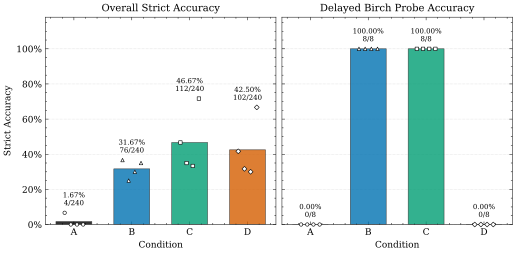

# Paper figure revisions

These figures were regenerated from saved, validated evidence. No experiment
was rerun. The originally published figures and results under `docs/results/`
remain unchanged, including their original checksums.

| Study | Revised figures and captions | Original evidence |
| --- | --- | --- |
| Integrated, four conditions | [Eight figure sets](integrated-004/README.md) | [Completed integrated study](../results/integrated-004/README.md) |
| Original A/B | [Four figure sets](study-20261111-002/README.md) | [Original study](../results/study-20261111-002/README.md) |

Each set includes SVG, PDF and 300-dpi PNG, plus a README with caption text and
`plot_data.json` with values, denominators, rendering versions and the source
manifest hash. Use SVG/PDF for paper layout. Figures use a 7.16-inch two-column
width; do not shrink a two-panel overview into a single narrow column.

Both studies use SciencePlots (`science`, `ieee`, `grid`, `no-latex`) and fixed
Okabe–Ito condition colors. Titles describe the outcome; methods and limitations
are in the captions. Synthetic outputs retain a visible provenance footer.

## Integrated conditions

- **A:** bounded linear history.
- **B:** graph without supersession or pruning.
- **C:** graph with supersession, pruning off.
- **D:** graph with supersession and pruning.

The left panel includes all 240 scored turns per condition. The right includes
the eight dedicated delayed Birch probes per condition. Points show the four
workload variants, not confidence intervals. B and C both scored 8/8 on Birch;
D scored 0/8. This scheduled contrast does not establish universal retention.
The original A/B study's **B** used full graph memory and differs from integrated
B. Keep condition definitions local to each study; do not pool their results.

The exact-gap companion displays all observed numeric recall gaps; the bucketed
version retains the original grouping. Both join markers with thin straight
lines to guide the eye; the lines do not estimate accuracy between sampled
gaps. Neither is a fitted forgetting curve.
Undefined recall gaps are excluded, and sample counts are retained in the data.
Latency is arithmetic mean elapsed turn time in seconds. Prompt-counter gaps
remain unknown; B's incomplete pipeline costs are not imputed.

See the [verification and regeneration protocol](../testing/paper_figures.md).
