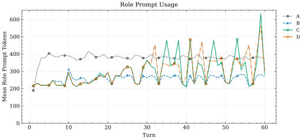
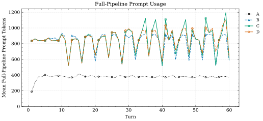
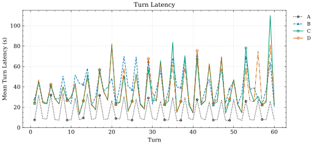
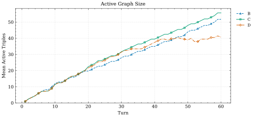
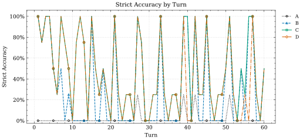
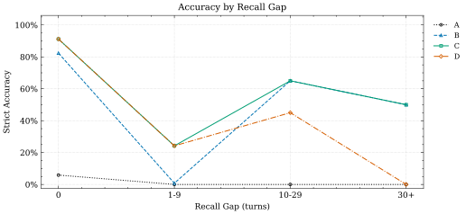
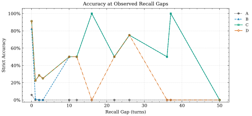
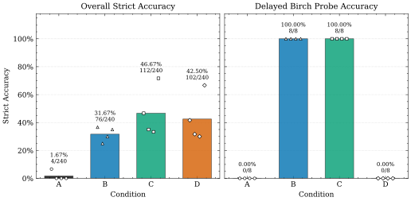

# Paper figures

Evidence source: **measured**.

Presentation revision only; no inference was run. The source bundle and
published analyses/figures are unchanged. Percentages use the original
strict scorer, including rejected replies as incorrect.

## Conditions

- **A**: Bounded linear history.
- **B**: Graph without supersession or pruning.
- **C**: Graph with supersession.
- **D**: Graph with supersession and pruning.

## Figure captions

### role_prompt_tokens

Per-turn arithmetic means across 4 workload variants. Role costs include role correction attempts. Full-pipeline costs also include observation/response extraction and corrections. A missing counter in any contributing variant leaves a gap; there is no imputation or selective-subset mean. Failed-attempt costs are included when counters are available.

### total_prompt_tokens

Per-turn arithmetic means across 4 workload variants. Role costs include role correction attempts. Full-pipeline costs also include observation/response extraction and corrections. A missing counter in any contributing variant leaves a gap; there is no imputation or selective-subset mean. Failed-attempt costs are included when counters are available.

### wall_ms

Per-turn arithmetic means across 4 workload variants. Recorded elapsed turn time converted from milliseconds to seconds. Includes the work and failed attempts recorded inside each turn; setup/warmups are outside these per-turn measurements.

### active_edges

Per-turn arithmetic means across 4 workload variants. A has no graph and is omitted. Counts are active logical triples, not database-space savings; soft-pruned records remain stored.

### accuracy

Per-turn arithmetic means across 4 workload variants. Original strict answer-contract scoring, including rejected replies as incorrect. Turns are not independent experimental repetitions.

### delayed_recall

Strict accuracy pooled within the declared recall-gap buckets. Scheduled counts per condition: 0: n=68, 1-9: n=128, 10-29: n=20, 30+: n=12. Points are categorical groups, not a fitted forgetting curve. Thin straight lines guide the eye between observed groups; they do not estimate accuracy between them. Undefined gaps (unknown-answer probes) are excluded. Gap measures turns since scheduled observation/questioning, not original fact age.

### delayed_recall_exact

Strict accuracy at every observed numeric recall gap, pooled across workload variants. Points use their actual numeric x positions. Thin straight connecting lines guide the eye; they do not estimate accuracy at unobserved gaps. No smoothing is applied. Overlapping values share coordinates; marker shapes distinguish conditions. Counts and successes at each gap are in plot_data.json. Undefined gaps are excluded. Question composition differs between gaps; this does not isolate forgetting alone.

### overall_accuracy

Left: overall strict accuracy across all scheduled turns, with successes/denominators. Right: the dedicated delayed Birch probes for all four conditions; B is retained to show its successful recall alongside C. Open markers are individual workload-variant scores, in the same left-to-right variant order within each bar; they are not independent turn samples or confidence intervals. The Birch comparison is a specific scheduled probe result, not a universal retention guarantee. The C–D difference is the observed pruning-policy contrast, not an identical-graph intervention. A’s low overall strict score also reflects answer-format failures and cannot be attributed entirely to forgetting.

## Rendering and data

SciencePlots styles: `science`, `ieee`, `grid`, `no-latex`.
Okabe–Ito condition colors and distinct markers/lines are fixed across plots.
DejaVu Serif is bundled with Matplotlib; no TeX or network assets are needed.
Figures use a 7.16-inch two-column width; the overview uses two panels.
Workload variants are paired descriptive observations, not independent turns.
No confidence intervals or significance claims are added.

`plot_data.json` contains the plotted values, denominators, variant scores,
rendering versions and source manifest hash. Null costs stay unknown.
