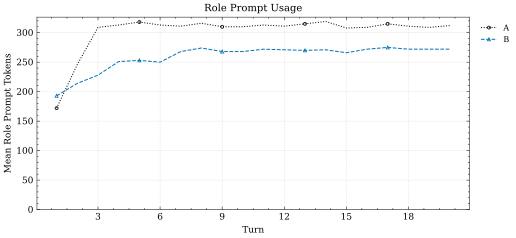
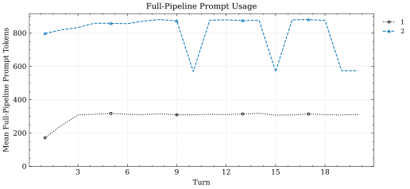
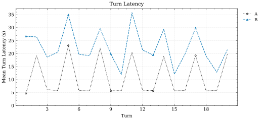
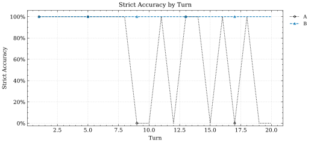

# Paper figures

Evidence source: **measured**.

Presentation revision only; no inference was run. The source bundle and
published analyses/figures are unchanged. Percentages use the original
strict scorer, including rejected replies as incorrect.

## Conditions

- **A**: Bounded linear history.
- **B**: Original full graph memory.

## Figure captions

### role_prompt_tokens

Arithmetic means across 2 original-study repetitions. A is bounded linear history; B is the original full graph-memory condition. The original B differs from integrated-study B; these studies must not be pooled. Role counts omit extraction work; pipeline counts include role and extraction attempts. Missing counters remain unknown (gaps), never zero or partial-subset means.

### total_prompt_tokens

Arithmetic means across 2 original-study repetitions. A is bounded linear history; B is the original full graph-memory condition. The original B differs from integrated-study B; these studies must not be pooled. Role counts omit extraction work; pipeline counts include role and extraction attempts. Missing counters remain unknown (gaps), never zero or partial-subset means.

### wall_ms

Arithmetic means across 2 original-study repetitions. A is bounded linear history; B is the original full graph-memory condition. The original B differs from integrated-study B; these studies must not be pooled. Measured elapsed turn time converted from milliseconds to seconds.

### accuracy

Arithmetic means across 2 original-study repetitions. A is bounded linear history; B is the original full graph-memory condition. The original B differs from integrated-study B; these studies must not be pooled. The original strict answer contract is unchanged.

## Rendering and data

SciencePlots styles: `science`, `ieee`, `grid`, `no-latex`.
Okabe–Ito condition colors and distinct markers/lines are fixed across plots.
DejaVu Serif is bundled with Matplotlib; no TeX or network assets are needed.
Figures use a 7.16-inch two-column width; the overview uses two panels.
Workload variants are paired descriptive observations, not independent turns.
No confidence intervals or significance claims are added.

`plot_data.json` contains the plotted values, denominators, variant scores,
rendering versions and source manifest hash. Null costs stay unknown.
