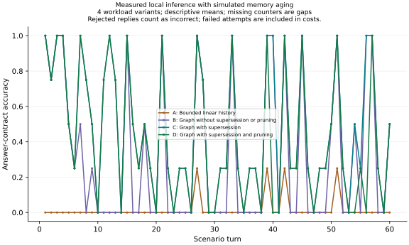
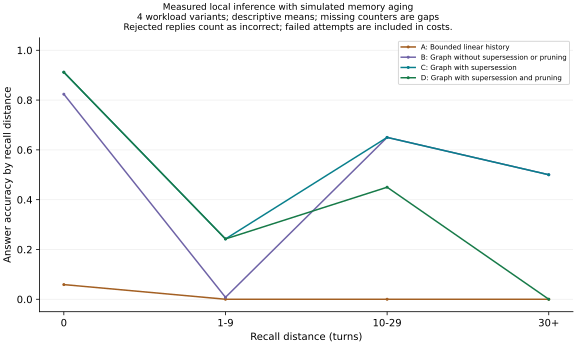
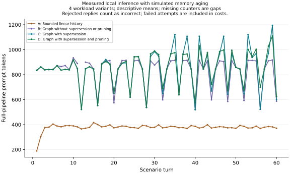

# Completed integrated memory experiment

The completed four-condition experiment supports automatic structural conflict
handling, but **does not establish the full proposed thesis**. Supersession
improved strict answer accuracy. Pruning reduced active graph size while losing
facts required later, with almost no reduction in pipeline prompt tokens relative
to supersession alone. All measurements and failed outcomes remain included.

## Design and validation

Bundle `e371076b0f2b4b708395db7c74ecfa46` completed on November 12, 2026:
16 runs, four seeded workload variants, 60 turns per condition per variant,
**960 scored role turns**. Protocol container version 4 uses protocol identifier
`integrated-memory-v3` and scenario `integrated-memory-v2`. Condition order was
ABDC, BCAD, CDBA, DACB. The 12 paired contrasts compare workload variants; turns
are not independent repetitions. Results are descriptive, without significance
claims. Earlier partial attempts are excluded, with no resumed or pooled rows.

Inference used installed `qwen2.5:7b` on node1 and `llama3.2:3b` on node2,
both Q4_K_M, at temperature zero, context 2,048 and role output cap 128.
The planner and verifier used node1; the researcher and extraction used node2.
The [manifest](bundle/manifest.json) records exact digests, parameters, source
hashes, package versions, warmups, prompts, scenarios and artifact checksums.
Source commit: `8753b25b36a3a41094c6642d4ffaf504387cc3e3`.

The memory allowance was a conservative 1,000-byte upper bound shared by the
bounded-history and graph conditions. Governance aged memory by **two simulated
hours per turn** (120 hours at turn 60). Inference and wall times were measured;
this was not five days of operation. The execution including setup and derived
outputs lasted approximately 8 hours 23 minutes.

Fresh analysis verified the complete cohort, artifact hashes, scenario and
policy declarations, attempt costs, transition replay, CSV projections and
SQLite integrity/checkpoint agreement. The regenerated summary exactly matched
the saved analysis. This checks evidence consistency, not scientific validity.
Private configuration, production data and previous results were preserved.

## Main outcomes

| Condition | Correct / 240 | Strict accuracy | Role prompt tokens | Pipeline prompt tokens | Mean turn time |
| --- | ---: | ---: | ---: | ---: | ---: |
| A: bounded linear history | 4 | 1.67% | 90,679 | 90,679 | 14.95 s |
| B: graph without supersession or pruning | 76 | 31.67% | 61,243 | Unknown | 39.03 s |
| C: graph with supersession, pruning off | 112 | 46.67% | 70,993 | 204,132 | 35.78 s |
| D: graph with supersession and pruning | 102 | 42.50% | 71,900 | 203,819 | 35.84 s |

Pipeline prompt counts include role requests, observation/response extraction
and correction attempts; role counts alone omit much of the graph's work.
B had three server repetition aborts during failed response extraction, all in
variant 2 (turns 12, 24, 36). The server supplied no token counters for those
attempts. Pipeline counter coverage is **237/240** B turns, with no imputation
or selective-subset total. Other conditions have complete coverage. Six role
replies were rejected (C: one; D: five) and scored incorrect; none were excluded.
No observation extraction failed. Scored answer-format compliance was 46/240,
118/240, 153/240 and 143/240 for A through D; this differs from JSON validity.

### Supersession: an effective invariant with a semantic limitation

C improved accuracy over B by **15 percentage points**, with per-variant changes
of +10.00, +10.00, +3.33 and +36.67 points (sample SD 14.78 points). B had active
single-valued conflicts on 216/240 turns, up to three conflicts at a time.
C and D had none. Updates scored 2/4 in B versus 4/4 in C and D; reversions scored
0/4 versus 3/4. This supports automatic replacement for the declared `uses`
predicate without runtime human arbitration.

However, having one active value does not ensure it is the right value.
At variant 1 turn 16, both C and D answered:

```text
CedarXEZP uses DBAAQEYF. CedarXEZP uses Unknown.
```

Both statements were extracted from the generated answer. The write of
`Unknown` superseded the correct fact, and turn 17's memory contained the wrong
active value. Source-grounded extraction verifies that a statement appears in
its source message; it does not make an agent's statement true. Across C and D,
79 and 65 probes respectively had required support marked SUPERSEDED.
The [selected raw audit](answer-audit.json) retains this chain and other examples.
These counts describe missing support states, not independently randomized
causal effects. Structural conflict resolution is demonstrated; reliable semantic
truth arbitration is not.

### Pruning: smaller active memory, poorer delayed recall

D recorded **72 triple pruning events**, versus zero in C. Mean final active
edges fell from **55.75 to 40.75**, a **26.9%** reduction. These are active logical
edges, not physical database-space savings; soft-pruned rows remain stored.
The runs evolve through different generated writes, so this is the observed
whole-policy difference, not an identical-graph subtraction.

The eight dedicated delayed Birch probes scored **8/8 in C and 0/8 in D**.
Every D probe had the required original fact marked PRUNED before answering.
Across the broader declared recall-gap-at-least-10 group, C scored **19/32**
(59.38%) and D **9/32** (28.13%), a decline of **31.25 percentage points**.
Recall gap measures turns since scheduled observation or questioning, not the
original age of a fact. Pruning losses are therefore visible both in explicit
delayed probes and the operational lag grouping. D had 24 probes with required
support in PRUNED state. Pinning did not guarantee correct answers: both C and D
scored 10/16 in the pinned category.

Overall accuracy declined **4.17 percentage points** from C to D, with declines
in all four variants: 5.00, 3.33, 3.33 and 5.00 points (sample SD 0.96 points).
D used only **313 fewer pipeline prompt tokens** than C, a **0.15%** reduction,
and 907 more role prompt tokens. Mean turn time was essentially unchanged.
This policy did not deliver a meaningful measured cost advantage to offset the
observed recall loss in this workload.

### Token bounds and baseline limitations

D used **20.7% fewer role prompt tokens** than A, but **124.8% more pipeline
prompt tokens** (2.25 times A's total). Mean turns took approximately 2.40 times
as long. This run supports compact role context at additional extraction cost;
it does not demonstrate total inference-token savings.

Both memory conditions were capped. A dropped history on 229/240 turns; its
largest rendered memory was 924 bytes versus D's 917. The largest unwindowed
A history was 25,139 bytes. A finite run with explicit caps cannot establish
asymptotic token bounds, constant cumulative consumption, or a hard bound on
stored graph size. Extraction prompts also require work beyond retrieved memory.

A's **1.67%** strict score is a major comparison limitation. Its first answer
already contained the correct fact followed by an extra fabricated sentence and
`Unknown.`, before any history truncation. Only 46/240 A answers met the scoring
format. Thus baseline errors cannot all be attributed to forgetting; instruction
following, answer contamination and representation also matter. The strict
predeclared scorer is retained without post hoc repairs. All conditions failed
all four cycle probes and all twelve unknown-answer probes. Even C's best
aggregate score was only 46.67%. The experiment tests the combined memory,
prompting, extraction and generation system, rather than memory capacity alone.
Role/model comparisons are also confounded by the fixed question schedule.

## Implications for the paper

- **Token bounds:** demonstrate enforced context caps and report both role and
  pipeline costs. Do not claim asymptotic superiority or total token savings.
- **Temporal conflicts:** demonstrate the automatic single-valued invariant and
  update/reversion results, while reporting incorrect generated writes that
  replace correct source facts.
- **Long-horizon fidelity:** the current pruning configuration fails the
  unqualified preservation claim. It forgot deliberately delayed facts that
  remained available and were answered correctly without pruning.
- **Distributed operation:** inference crossed two nodes with centralized
  orchestration and SQLite. The study does not test replicated state, network
  partitions, independent distributed writers or operational fault tolerance.

A defensible characterization is: **a bounded-context, locally distributed
multi-agent framework whose supersession improves state consistency, while its
pruning exposes a measurable retention-versus-active-memory tradeoff.**
The biological analogy motivates a policy; it is not biologically validated.

Before another measured study, consider separating authoritative observations
from generated assertions, representing abstention outside the fact graph, and
adding provenance-aware admission before supersession. Pruning could use an
explicit recovery path or protected task dependencies for old required facts.
Any revised evaluation should include a frozen, offline prompt/answer-contract
preflight and a separate graph-availability metric alongside unchanged strict
answer scores. Those are proposed changes, not changes made for this report.
Do not tune against these results and present the same workload as an unseen
confirmation set. More turns alone would not address the observed failures.

## Evidence, figures and verification

The complete immutable bundle is copied under [bundle/](bundle/manifest.json),
including all 16 SQLite files, per-run CSVs, JSONL attempts/answers/transitions and
metrics. [Summary](analysis/summary.json), [paired contrasts](analysis/contrasts.csv)
and [curves](analysis/curves.csv) are derived outputs, with six figure sets in
SVG/PDF/PNG. Original runtime files and previous reports remain unchanged.







From the repository root with the existing environment active, use a fresh output:

```bash
python3 -m experiments.integrated_analysis --input docs/results/integrated-004/bundle --output .verification/integrated-004-analysis-review-001
```

Expected:

```text
INTEGRATED ANALYSIS OK: source=measured variants=4 contrasts=12
```

To regenerate figures without contacting models, use another fresh output:

```bash
python3 -m experiments.integrated_analysis --input docs/results/integrated-004/bundle --output .verification/integrated-004-figures-review-001 --figures
```

Expected: `FIGURES OK: 18 files (SVG, PDF, PNG)`.

The existing automated validator suite can be run independently:

```bash
python3 -m pytest tests/test_phase8_integrated.py -q
```

Expected: `116 passed`. This suite uses synthetic HTTP; it is not another
experiment. `published-sha256.json` covers every published artifact except itself,
including this report and derived outputs. These checksums detect changed files;
they do not validate the scientific interpretation. No new inference was run.
