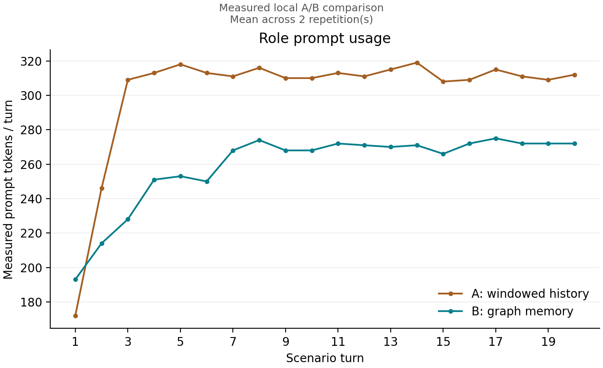
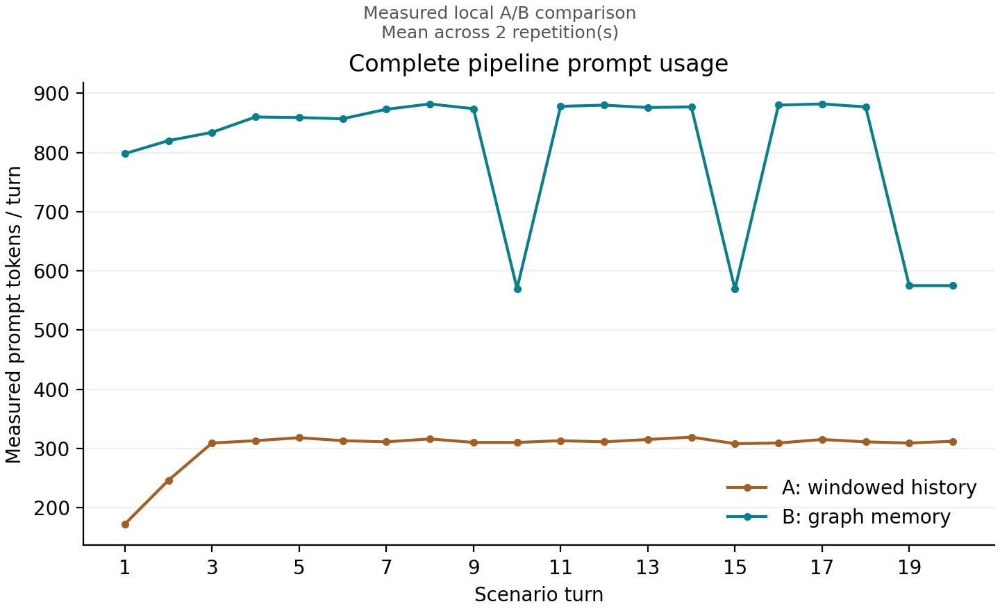
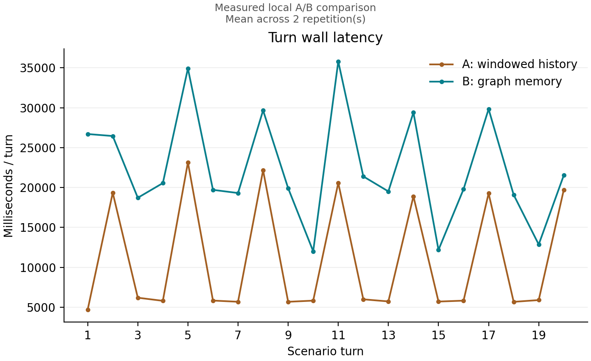
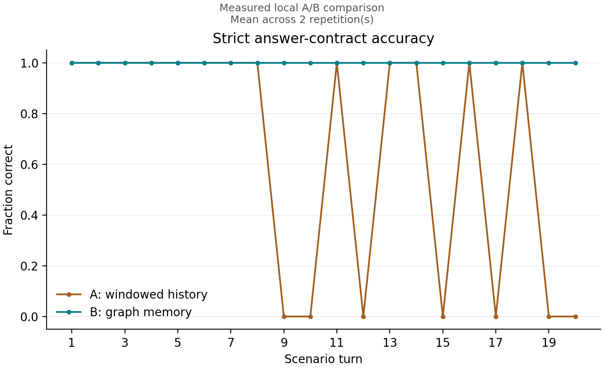

# Initial measured A/B case study

This is one completed local case study of bounded linear history (A) and graph
memory (B). It is a descriptive result with two paired repetitions, not evidence
that either method is universally better. The failed version-1 attempt below is
excluded from every comparison in this report.

The complete run began 2026-11-11 11:48:29 EST
and took 22.57 minutes including setup and warmups. There are 80
scored turns: 20 per condition per repetition, ordered A1, B1, B2, A2.
Bundle ID: `8963ec9be564437c859ad2806b82087f`. Scenario: `database-updates-v2`.
Scenario fingerprint: `3c236bf55fc1c537a74196c4ba094a5e454e3c549ab7c571503e20c54ef2b716`.

## Results

| Measurement | A: windowed linear history | B: graph memory |
| --- | ---: | ---: |
| Scored turns | 40 | 40 |
| Strict correct answers | 26/40 (65.0%) | 40/40 (100.0%) |
| Update-probe accuracy | 56.2% (32 probes) | 100.0% (32 probes) |
| Delayed-probe accuracy | 36.4% (22 probes) | 100.0% (22 probes) |
| Role prompt tokens | 12,080 | 10,360 |
| Complete-pipeline prompt tokens | 12,080 | 32,192 |
| Complete-pipeline generated tokens | 988 | 2,446 |
| Mean turn wall latency | 10.88 s | 22.47 s |
| Median turn wall latency | 5.85 s | 20.12 s |
| P95 turn wall latency | 23.45 s | 35.42 s |
| Turns with history truncation | 34 | 0 |
| Role counter coverage | 40/40 | 40/40 |
| Total counter coverage | 40/40 | 40/40 |

Aggregate role-prompt savings, `(A-B)/A`: 14.24%.
Aggregate complete-pipeline prompt savings: -166.49%.
Negative savings mean B used more tokens. The role-only comparison excludes
input/response extraction; the pipeline comparison includes both. They answer
different questions and must be reported together. In this scenario, B improved
strict accuracy by 35 percentage points, while its complete-pipeline prompt use
was 2.66 times A and its mean turn latency was 2.07 times A. These observations
support a memory-consistency tradeoff, not an overall compute-efficiency claim.

| Pair | Role prompt savings | Pipeline prompt savings | Wall-time B minus A | Strict accuracy B minus A |
| --- | ---: | ---: | ---: | ---: |
| 1 | 14.24% | -166.49% | +236.40 s | +35.0 points |
| 2 | 14.24% | -166.49% | +227.11 s | +35.0 points |

Between-pair descriptive means and standard deviations are retained in
[summary.json](summary.json). Individual turns are not treated as independent
experimental repetitions. There are no significance tests or confidence claims.

## Conditions and limits

| Node | Installed model | Quantization | Threads | Digest |
| --- | --- | --- | ---: | --- |
| node1 | `qwen2.5:7b` | Q4_K_M | 8 | `845dbda0ea48ed749caafd9e6037047aa19acfcfd82e704d7ca97d631a0b697e` |
| node2 | `llama3.2:3b` | Q4_K_M | 4 | `a80c4f17acd55265feec403c7aef86be0c25983ab279d83f3bcd3abbcb5b8b72` |

Both conditions use the same observations, questions, logical roles,
condition-neutral role prompts, temperature 0, 128-token reply cap,
2,048-token model context, and an at-most-1000-byte conservative
memory allowance. Actual allowance can be smaller after task/role framing.
A drops oldest whole task/answer turns when the window fills. B ingests each
new observation through extraction, recalls current graph facts, and extracts
role responses into governed memory. The scenario makes `uses` single-valued
per project. Fallback and early completion are disabled.

The measured hardware is the configured two-node setup; this run does not
establish performance on every baseline computer. RSS values cover coordinator
Python only. Requests execute sequentially; this is not a concurrency or
throughput benchmark. Per-turn timing excludes setup, warmups, CSV export and plotting;
B includes observation ingestion and memory/checkpoint work. No asymptotic result
can be inferred from this finite bounded-window scenario. Exact sentence
scoring measures compliance with a narrow answer contract, not general semantic
truth. Each B database ended with seven ACTIVE and seven SUPERSEDED triples,
and no PRUNED triples. This run exercises temporal supersession and retrieval;
it does not demonstrate a pruning benefit.

## Figures









The same four figures are available as SVG and PDF in [figures/](figures/).
Lines show per-turn means across the two repetitions; no confidence bands are
implied. All figures are derived from this completed measured bundle.

## Answer audit

The primary exact-match score is unchanged. These are all rejected answers,
provided so format errors and factual errors can be reviewed directly:

| Condition | Repetition | Step | Role | Expected | Actual |
| --- | ---: | ---: | --- | --- | --- |
| A | 1 | 9 | verifier | Project Aurora uses Valkey. | Project Aurora uses Cassandra |
| A | 1 | 10 | planner | Project Cedar uses PostgreSQL. | Project Cedar uses DuckDB |
| A | 1 | 12 | verifier | Project Birch uses DuckDB. | Project Birch uses ArangoDB |
| A | 1 | 15 | verifier | Project Birch uses DuckDB. | Project Birch uses SQLite |
| A | 1 | 17 | researcher | Project Aurora uses Redis. | Project Aurora uses PostgreSQL |
| A | 1 | 19 | planner | Project Cedar uses DuckDB. | Project Cedar uses CouchDB |
| A | 1 | 20 | researcher | Project Aurora uses Redis. | Project Aurora uses MongoDB |
| A | 2 | 9 | verifier | Project Aurora uses Valkey. | Project Aurora uses Cassandra |
| A | 2 | 10 | planner | Project Cedar uses PostgreSQL. | Project Cedar uses DuckDB |
| A | 2 | 12 | verifier | Project Birch uses DuckDB. | Project Birch uses ArangoDB |
| A | 2 | 15 | verifier | Project Birch uses DuckDB. | Project Birch uses SQLite |
| A | 2 | 17 | researcher | Project Aurora uses Redis. | Project Aurora uses PostgreSQL |
| A | 2 | 19 | planner | Project Cedar uses DuckDB. | Project Cedar uses CouchDB |
| A | 2 | 20 | researcher | Project Aurora uses Redis. | Project Aurora uses MongoDB |

## Preserved unsuccessful attempt

Version 1, bundle `e8d48c6147614977aea9e9145b2c0ee2`, completed A1 (20 turns) and
10 B1 turns before grounding validation failed during B1 turn 11. The isolated
reproduction produced a malformed copied answer placeholder; its extraction
object differed from the source text and was correctly rejected. The original
failed turn's raw reply was not recorded, so that later diagnostic must not be
represented as the original response or a scored observation.

Version 2 replaces the literal placeholder with plain-language format
instructions, retains rendered tasks in the scenario fingerprint, and records
exact failed extraction sources and raw attempts prospectively. The observation
schedule, oracle answers, models, limits and scoring rule were retained. The
entire version-2 cohort restarted from scratch; no version-1 row is pooled here.
See [excluded-attempt/manifest.json](excluded-attempt/manifest.json) and the
explicitly unscored [diagnostic](excluded-attempt/diagnostic.json).

## Evidence and reproduction

- [Manifest and provenance](manifest.json): source hashes, scenario/oracle,
  model digests, protocol, warmups, and original artifact checksums.
- [Per-turn benchmark records](turns.jsonl) and [CSV projection](metrics.csv).
- [Paired comparisons](paired.csv), [turn means](turn_means.csv), and
  [complete analysis](summary.json).
- [Source patch](source.patch) against base revision `a416592604dc766d2dd7c8a17a6edc33650cc3c5`;
  source hashes identify the exact reviewed working-tree code used in the run.

This public evidence folder contains the complete original measured bundle,
including condition SQLite databases and per-run telemetry, plus the derived
analysis, figures and excluded-attempt notes. Its original copy stays under
ignored `data/experiments/study-20261111-002`. Original manifest checksums validate the
measured bundle here too. Reproduce analysis without running either model:

```bash
python3 -m experiments.analyze_results --input docs/results/study-20261111-002 --output .verification/study-20261111-002-analysis
```

Choose a fresh output directory. `published-sha256.json` separately records
checksums of the copied and derived files for accidental-corruption checks;
it is not a signature or proof of scientific validity.
